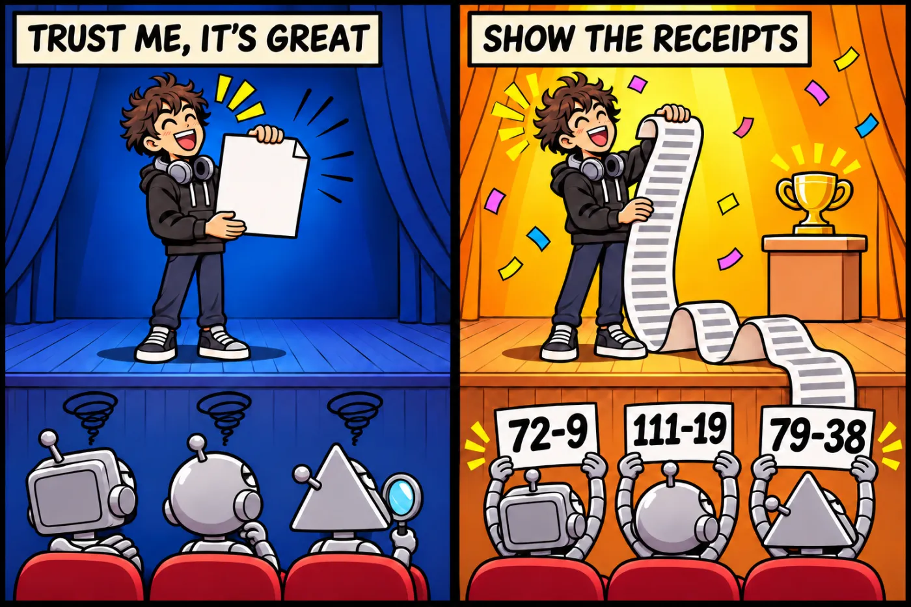
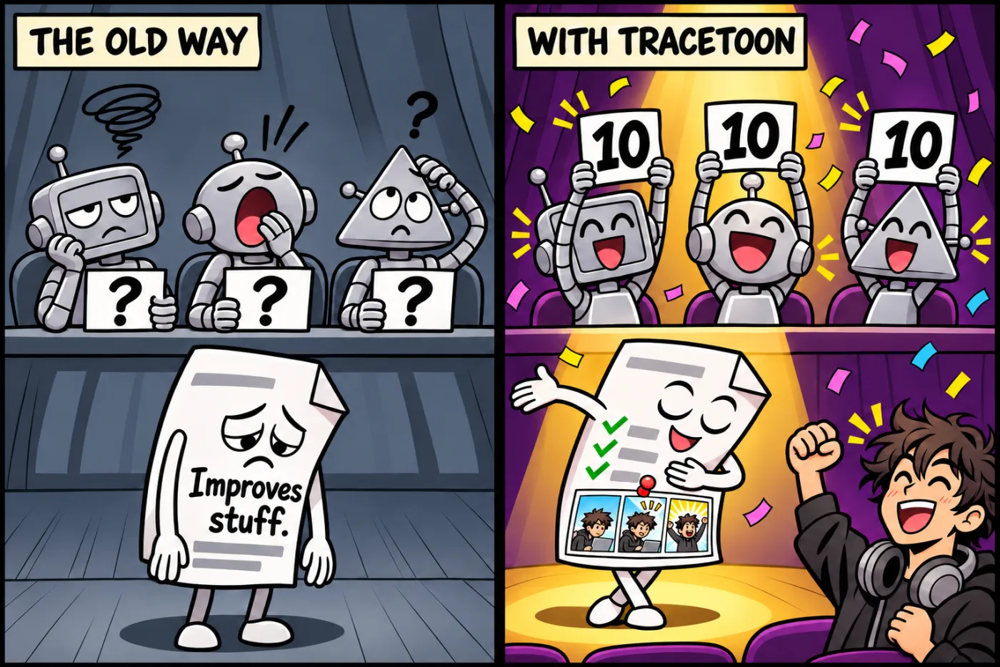
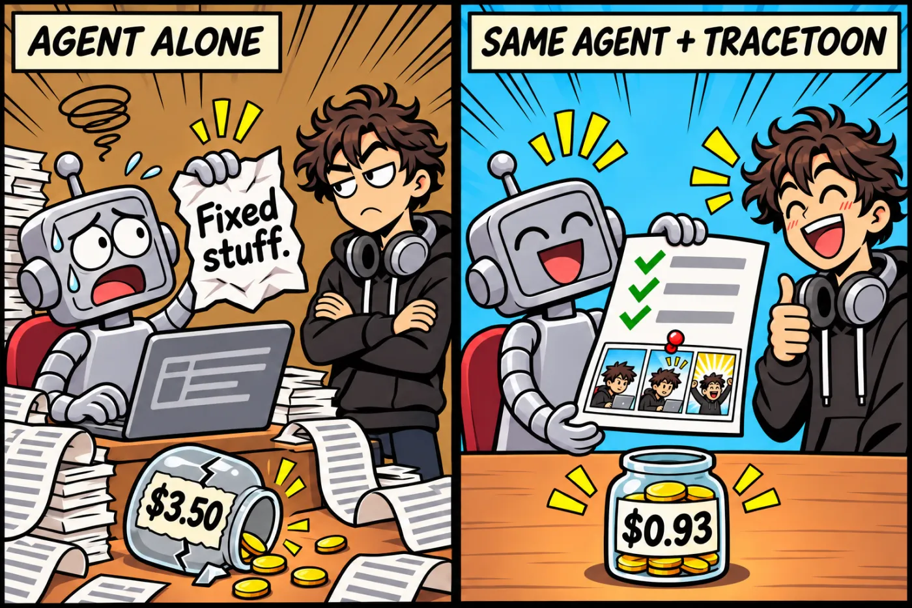
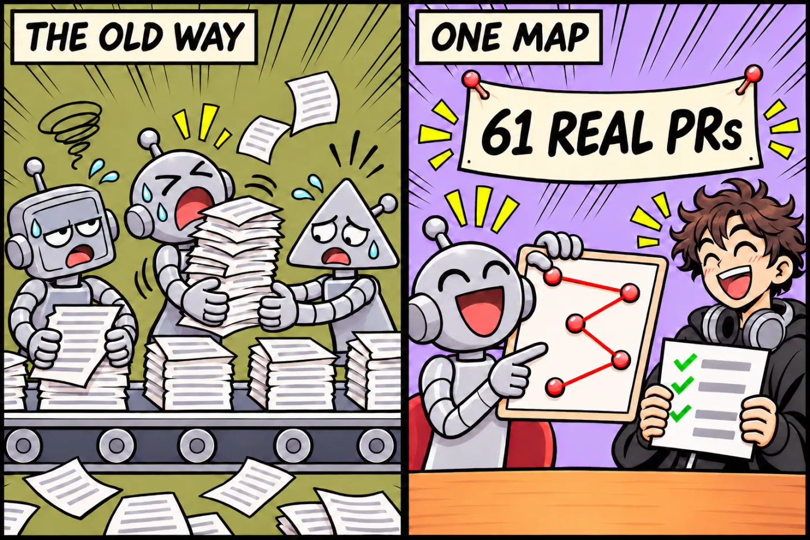
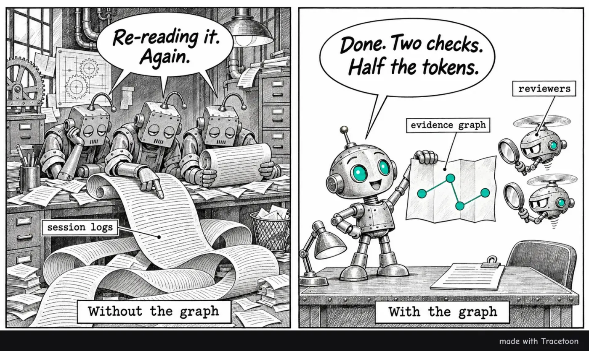

# prbench

**Other benchmarks read the diff. prbench reads the receipts.**

<p align="center"><a href="https://tracetoon.ai/prbench.html#results"></a></p>

prbench measures whether a PR-writing tool helps AI coding agents write better pull requests. It replays real agent work sessions and asks each system to write the pull request. Judges then score every draft against an expert-reviewed fact sheet for the change.

The question it answers: **does an agent with this tool write a more accurate and more useful PR than the same agent without it, and at what cost?**

## What makes it different

A diff shows what changed. The session shows why. An AI agent's pull request is the end of a long conversation: the user explained the goal, the agent made a plan, tried things and ran tests. A PR tool worth using turns that into a description a reviewer can trust, and you can only measure that if the benchmark has the conversation too. As far as we know, no other PR test framework replays the pull request from the agent's actual session logs and runs the PR tool the way it really runs.

| Question | Typical PR benchmarks | prbench |
| --- | --- | --- |
| Does it replay the agent's real session? | No: PR datasets hold diffs, comments and outcomes | Yes: each case ships the redacted Claude Code or Codex sessions that produced the change |
| Can it see what was asked and what ran? | Only what the diff and commit messages imply | Requests, plans, decisions and recorded test runs, for writers and judges alike |
| Does the tool run the way it runs for real? | Usually a model prompted with the inputs | The real agent CLI with the tool installed, in an isolated sandbox with its own home and a fake `gh` |
| Are claims checked against evidence? | Text overlap with a reference, or one overall score | Claim by claim against an expert-reviewed fact sheet, traps included |
| Is judging blind and paired? | Often one reading per output | Branding stripped, two judges, both orders; a win needs both |
| Are flagged errors double-checked? | The judge's word is final | Every flag goes to expert models; only confirmed errors count |
| Does it report what quality costs? | Rarely | Cost per draft from measured token use, compared pair by pair |

"Typical" describes the common setup of PR-description and code-review evaluations in our [related-work survey](docs/related-work.md), not any one project.

<p align="center"><br><sub>The real judges are less excitable: two per provider, each reading every pair twice, with the drafts swapped.</sub></p>

- **Real sessions, replayed end to end.** Each case is a real piece of work by Claude Code or Codex: the repository at the commit before the change, the commits that made it, and the session logs, redacted and cut to that change. The writer runs in a sandbox on that checkout, with those logs in its home directory, and opens its PR through a fake `gh`. A PR tool can read the actual session, as it would on a developer's machine.
- **Expert fact sheets.** Every case has a fact sheet listing the claims a good description makes, the context a reviewer needs, what the evidence leaves open, and tempting wrong statements ("traps"). Each fact cites the exact lines of code or session that support it. Sheets are written from the code and sessions, never from a published PR. A panel of Claude and GPT models reviews each sheet against the raw evidence and accepts a change only when both model families agree; judges settle disputes. Writers never see the sheets.
- **Two judges, both orders.** Each pair of drafts is judged twice by each of two judges, once in each order, and judges never see which tool wrote which draft. A preference counts only when both orders agree. The headline count needs both judges to agree as well.
- **Expert accuracy review.** Every claim a judge flags as wrong, on either arm, goes to two further expert models (Claude Fable and GPT-6 Astra) that check it against the source. Confirmed errors are counted per draft, and the quality gate compares the candidate's rate with the baseline's.
- **Cost and frozen inputs.** Writer tokens are priced per model, subagents included. Skills, binaries, cases, CLI versions and the launch environment are hashed into the experiment identity. A resume accepts only identical inputs, and cached drafts are reused only on exact matches.

Methodology: [docs/methodology.md](docs/methodology.md). Related work: [docs/related-work.md](docs/related-work.md).

## Results

prbench is behind all three published Tracetoon results, newest first:

1. **Flagship:** Tracetoon against the same agent writing the PR on its own, on Opus 5.5 and Sol 6.1 (61 cases × 3).
2. **The v4 golden run:** Tracetoon's evidence-graph brief against its original multi-agent workflow (61 cases × 3).
3. **The first evidence-graph study:** the same graph-vs-original comparison on 5 cases × 5, before it was repeated at scale.

<table>
<tr>
<td align="center" width="33%"><a href="https://tracetoon.ai/vs-native.html"></a><br><b>Flagship</b><br><sub>Tracetoon vs your agent alone</sub></td>
<td align="center" width="33%"><a href="https://tracetoon.ai/evidence-graph-61.html"></a><br><b>The v4 golden run</b><br><sub>The evidence graph on 61 real PRs</sub></td>
<td align="center" width="33%"><a href="https://tracetoon.ai/evidence-graph.html"></a><br><b>The first study</b><br><sub>5 PRs × 5, before the scale-up</sub></td>
</tr>
</table>

Each report, with its charts and caveats, is summarised on the [Tracetoon benchmark page](https://tracetoon.ai/prbench.html#results).

### Tracetoon vs no Tracetoon on flagship models

The user's own agent writing the PR with no Tracetoon (`native`), against the same agent using Tracetoon `candidate70b`. Both run in a Claude Code session on Opus 5.5 and a Codex session on Sol 6.1. The run used 61 real cases × 3 replicates per provider, two judges per provider in both orders, and the same accuracy review. Data, drafts, cost model and commands: [golden/v4-flagship-c70b/](golden/v4-flagship-c70b/).

| | Claude Code (Opus 5.5) | Codex (Sol 6.1) |
| --- | --- | --- |
| Composite score, native → Tracetoon | 52.8 → **68.3** (+15.5 ± 2.0) | 64.1 → **78.1** (+14.0 ± 1.2) |
| Consensus picks, Tracetoon–native | **72–9** | **111–19** |
| Judge-flagged factual errors per draft | 0.32 → **0.16** | 0.18 → **0.15** |
| Cost per PR, 500k-token warm session | $1.29 → **$0.93** (0.72×) | $3.50 → **$0.93** (0.27×) |

The session's own model only coordinates (about 4–6 requests). A fresh drafter on the same model at low effort writes from the evidence brief, and cheap reviewers check it (Haiku / Luna). Cost assumes a 500k-token session with subscription-style caching (main thread 1 h, subagents 5 min; Codex 30 min). Without a long carried session, Tracetoon costs more than the native agent. Details and caveats are in the bundle's README.

### The v4 golden run

Tracetoon's evidence-graph skill (`candidate62`) against Tracetoon's original workflow. The run used 61 real cases × 3 replicates per provider, with two pre-registered judges per provider, each judging every pair in both orders, and an expert accuracy review of every flagged claim. Data, drafts and commands: [golden/v4-candidate62/](golden/v4-candidate62/). Write-up: [the Tracetoon evidence page](https://tracetoon.ai/evidence-graph-61.html).

| | Codex (writer gpt-6.1-terra) | Claude Code (writer claude-sonnet-5-5) |
| --- | --- | --- |
| Consensus picks, candidate–original | **79–38 (68%)**, CI 56–79% | **60–21 (74%)**, CI 62–85% |
| Composite score delta (0–100) | **+3.3** [1.0, 5.5] | **+3.5** [0.8, 6.1] |
| Writer cost, candidate / original | **0.30** [0.28, 0.32] | **0.57** [0.53, 0.62] |
| Confirmed accuracy errors per draft, candidate vs original | 0.33 vs 0.16 | 0.47 vs 0.84 |
| Strict accuracy gate (no worse than the original + 0.05) | fails | passes |
| Key facts conveyed (claim coverage), candidate vs original | **82% vs 72%** | 73% vs 77% |

**How to read the table:**
- **Consensus picks** count the cases × replicates where both judges, in both orders, preferred the same draft. Ties and split decisions are left out.
- **Composite score** is 35·claims + 15·context + 15·uncertainties + 35·rubric, minus penalties for factual errors, unsupported claims and traps, averaged per case.
- **Intervals** are 95% bootstrap intervals clustered by case.
- **In-sample results.** The pool has no held-out split, and the candidate was tuned on these cases.
- **Codex accuracy.** The Codex candidate makes more confirmed errors than the original workflow. This is disclosed in the run details, and most of those errors trace to known Validation-section render bugs.
- **Claude Code coverage.** On Claude Code the candidate conveys slightly fewer key facts (73% vs 77%), within the 5-point coverage margin.

### The first evidence-graph study

Tracetoon's evidence-graph build at the time (`bd55f75`, on Relate) against its original workflow, on the 5 dev cases of `real-cases@1.0.0` × 5 replicates per arm, rubric v6. Same writers and judges as the golden run. Method, commands and the run-to-run comparison: [docs/reproduce-graph-vs-base.md](docs/reproduce-graph-vs-base.md). Write-up: [the first evidence-graph study](https://tracetoon.ai/evidence-graph.html).

| | Codex (writer gpt-6.1-terra) | Claude Code (writer claude-sonnet-5-5) |
| --- | --- | --- |
| Consensus picks, graph–original | **12–1** (12 ties) | **18–1** (6 ties) |
| Composite score, original → graph | 83.2 → **86.6** (+3.5 [1.8, 5.1]) | 73.7 → **78.9** (+5.2 [2.5, 8.0]) |
| Judge-flagged factual errors per judgment, graph / original | **0.00** / 0.07 | 0.08 / 0.09 |
| Writer cost per draft, graph / original | **$0.207** / $0.320 | **$0.407** / $0.690 |

Five cases from one repository make this a small, early test. A same-build Codex rerun gave +5.2 (13–2), about the ±3-point run-to-run noise to expect at 25 pairs.

## Run it yourself in 3 steps

The cases are a public download: frozen repository bundles, redacted sessions and fact sheets, consented by their owners. You need Bun 1.3.14+, Git, and the Codex or Claude Code CLI for the model steps.

1. **Install prbench** from the GitHub release:
   ```sh
   bun install --global https://github.com/Tracetoon/prbench/releases/download/v0.4.0/prbench-0.4.0.tgz
   ```
2. **Fetch the cases.** Downloads, verifies every file's checksum and caches the 61-case library. No account, no model calls.
   ```sh
   prbench datasets fetch real-cases@4.0.0
   prbench preflight --dataset real-cases@4.0.0
   ```
3. **Compare two builds.** Sign in a separate benchmark login (`prbench auth codex`), preview the plan for free with `--plan`, then run the same command without it and score:
   ```sh
   prbench compare --provider codex --models gpt-6.1-terra@medium \
     --systems baseline,candidate --purpose diagnostic \
     --dataset real-cases@4.0.0 \
     --baseline-skill skills/baseline --candidate-skill skills/candidate \
     --out results/my-run --plan
   prbench score results/my-run --dataset real-cases@4.0.0
   ```

For a cheaper first pass, add `--replicates 1`. The sections below cover a source checkout, the dataset, both providers, judges and recovery in full.

### What a run costs, and how long it takes

Everything up to the run itself is free. The paid part is your writers and your judges, on your own model login.

| Step | Cost | Time |
| --- | --- | --- |
| Fetch, preflight, `--plan`, `--prepare-only` | Free, no model calls | Minutes |
| Writers (your tool) | Whatever your tool spends. Tracetoon in the golden run: $0.13–$0.45 per draft on Codex, $0.34–$0.65 on Claude Code | About 5–8 min per draft (median), many in parallel |
| Judges on Codex (Sol + Terra) | Uses your Codex login's quota; prbench records no dollar cost | A 25-pair run takes about 30–40 min at `--parallel 10` |
| Judges on Claude (Opus + Sonnet) | About $1.60 per pair (4 readings), from our 25-pair reference run | |

The full library at 3 replicates is 183 pairs per provider (366 drafts, 732 judge readings); with `--replicates 1` it is a third of that. Judges are stochastic, so a rerun won't match our numbers exactly; expect the same direction with intervals of similar width. The golden run's own totals are under [Reproduce the results](#reproduce-the-results).

## Install

Needs [Bun](https://bun.sh) 1.3.14 or later and Git. Running comparisons also needs the [Codex CLI](https://github.com/openai/codex) and/or [Claude Code](https://docs.anthropic.com/en/docs/claude-code), signed in with your own account.

```sh
git clone https://github.com/Tracetoon/prbench
cd prbench
bun install --frozen-lockfile
bun run prbench --help
```

A packaged release is also available: `bun install --global https://github.com/Tracetoon/prbench/releases/download/v0.4.0/prbench-0.4.0.tgz` installs the `prbench` command with the v4 harness and the 4.0.0 dataset registry. With the package, drop the `bun run` prefix from the commands below.

## Quick start: a smoke test with no model calls

The repository ships one synthetic case (`cases/example-greet-default`). These commands check it, replay its published PR as a draft, and validate the output, without calling any model:

```sh
bun run prbench validate                  # check every case under cases/
bun run prbench systems                   # list the systems that can run
bun run prbench run -s original -o results/smoke/artifacts
bun run prbench check-artifact results/smoke/artifacts/example-greet-default/original.json
bun run test && bun run typecheck         # the full suite takes about 6 minutes
```

## Get the dataset

The real cases are distributed as a versioned, checksummed download, kept out of Git. `real-cases@4.0.0` holds the 61 cases of the golden run, all in one `dev` pool. Each case has a repository bundle, redacted sessions, a fact sheet with provenance, and pinned preparation steps.

```sh
bun run prbench datasets list
bun run prbench datasets fetch real-cases@4.0.0             # into ~/.cache/prbench/datasets
bun run prbench datasets fetch real-cases@4.0.0 --out cases-v4   # or into a new local folder
bun run prbench preflight --dataset real-cases@4.0.0        # checks provenance, no model calls
```

The 4.0.0 archive is published as the [`cases-v4.0.0` release](https://github.com/Tracetoon/prbench/releases/tag/cases-v4.0.0). Downloads need no account. Every file is verified against the registry's SHA-256 values, and no setup command runs at download time. The [dataset card](datasets/DATASET_CARD.md) covers composition, consent, redaction, licenses and limitations, and [docs/datasets.md](docs/datasets.md) covers the download workflow.

## Run a comparison

A comparison runs two (or three) systems on every case: the provider's agent with a **baseline** skill, the same agent with a **candidate** skill, and optionally the agent with no skill (`native`). Each skill directory must contain its platform binary in `bin/`. For Tracetoon, see [building the bundles](docs/reproduce-graph-vs-base.md#build-the-two-skill-bundles).

Set up a separate benchmark login first. Sandboxes get their own `HOME`, so your interactive login is never copied in:

```sh
bun run prbench auth codex                       # browser sign-in into ~/.prbench/codex-auth
claude setup-token                               # prints a long-lived token, then:
bun run prbench auth claude < token.txt          # stores it in ~/.prbench/claude-oauth-token
```

Freeze the inputs and inspect the plan, still without model calls:

```sh
bun run prbench compare --provider codex --dataset real-cases@4.0.0 \
  --baseline-skill skills/baseline --candidate-skill skills/candidate \
  --systems baseline,candidate --out results/my-run --prepare-only
bun run prbench compare <same arguments> --resume --plan
```

**Codex**: gpt-6.1-terra writes; Sol and Terra judge.

```sh
bun run prbench compare --provider codex --models gpt-6.1-terra@medium \
  --judges codex:gpt-6.1-sol@medium,codex:gpt-6.1-terra@medium \
  --systems baseline,candidate --replicates 3 --purpose diagnostic \
  --baseline-skill skills/baseline --candidate-skill skills/candidate \
  --dataset real-cases@4.0.0 --parallel 6 --out results/my-run/codex
```

**Claude Code**: Sonnet writes; Opus and Sonnet judge.

```sh
bun run prbench compare --provider claude --models claude-sonnet-5-5@medium \
  --judges claude:claude-opus-5-5@medium,claude:claude-sonnet-5-5@medium \
  --systems baseline,candidate --replicates 3 --purpose diagnostic \
  --baseline-skill skills/baseline --candidate-skill skills/candidate \
  --dataset real-cases@4.0.0 --parallel 6 --out results/my-run/claude
```

Then review the flagged claims and rebuild the report:

```sh
bun run prbench accuracy-review --run results/my-run/codex --cases <cases dir> \
  --out results/my-run/codex-accuracy --decider claude-fable-5-1 --write
bun run prbench compare <same arguments as the run> --resume --report-only
bun run prbench score results/my-run/codex --cases <cases dir>   # per-draft scores and cost
```

**Options and recovery:**
- **Judges.** `--judges` takes one comma-separated list; repeating the flag keeps only the last judge.
- **Purpose.** `--purpose confirmation` (the default) drafts everything fresh and enforces the adoption gate. `diagnostic` allows exact-match draft reuse across runs.
- **Interrupted runs.** Resume with the same command plus `--resume`, and add `--recover-lock` if the controller died. After a reboot, add `--accept-environment-change`.
- **Status.** `bun run prbench status --experiment <out>` reports progress without launching calls.
- **Timeouts.** `PRBENCH_WRITER_TIMEOUT_MS` sets the writer timeout (default 30 min; frozen in the experiment). `PRBENCH_JUDGE_TIMEOUT_MS` or `--judge-timeout-ms` sets the judge timeout (default 15 min; may be raised on resume).
- **Exit codes.** 0 passed, 1 a gate failed, 2 incomplete or invalid, 3 inconclusive, 130 cancelled.

## Reproduce the results

- **Flagship:** [golden/v4-flagship-c70b/README.md](golden/v4-flagship-c70b/README.md#rerunning) is a step-by-step guide, checked from a clean clone: tagged harness revisions (`bench-v4-flagship-claude`, `bench-v4-flagship-codex`), the published dataset, the `candidate70b` bundle rebuilt from its tag, and both `compare` commands.
- **First evidence-graph study:** [docs/reproduce-graph-vs-base.md](docs/reproduce-graph-vs-base.md).
- **The v4 golden run:** below.

### The v4 golden run

[golden/v4-candidate62/README.md](golden/v4-candidate62/README.md) has the full procedure. In short:

1. **Harness.** Check out `fa3db9c`, the harness revision recorded in the run's manifests, or use this branch, whose later commits only add macOS/Windows fixes and resume options.
2. **Skills.** Build the baseline bundle from Tracetoon tag `v1.0.0-rc.24` (`9ac29c4`) and the candidate from tag `candidate62` (`8d9783f`). Compare them with `golden/v4-candidate62/skills.json`.
3. **Writer CLIs.** Pin Claude Code 2.1.319 (`npm install @anthropic-ai/claude-code@2.1.319`, then `PRBENCH_CLAUDE_COMMAND='["<path>/node_modules/.bin/claude"]'`). The run used Codex CLI 0.169.0.
4. **Environment.** `PRBENCH_WRITER_TIMEOUT_MS=3600000 PRBENCH_JUDGE_TIMEOUT_MS=1800000 TMPDIR=/var/tmp`.
5. **Run.** Use the two `compare` commands above with `--cases <real-cases 4.0.0> --preparation <cases>/preparation.json --split dev`, then `accuracy-review --decider claude-fable-5-1 --write` and `--resume --report-only`. The exact scripts are in `golden/v4-candidate62/commands/`.

**Cost and time.** A full run is 366 drafts and 732 judge calls per provider, plus the accuracy review.
- **Claude Code**, at API prices: about $620 (writers about $183, judges $273, accuracy review $167).
- **Codex** does not report USD costs; its writers are estimated at about $105.
- **Time.** A run from scratch has about 43–51 writer-hours per provider: roughly 7–9 hours at `--parallel 6` with both providers running at once, plus judging. Memory, not CPU, limited concurrency: 16 concurrent writers ran a workstation out of memory.

The golden run reused cached original-workflow drafts and took about 4 hours per provider.

## Output layout

A `compare --out <dir>` folder holds:

| Path | Contents |
| --- | --- |
| `manifest.json` | frozen experiment: skill identities, case hashes, writer and judge contract hashes, settings, harness revision |
| `summary.md`, `summary.json` | the report: consensus picks, per-judge head-to-head, components, cost, gates |
| `<model>/artifacts/<case>/<system>.json` | each draft (title, body, commits, diff, validation evidence, run metadata); replicates 2+ under `replicate-00N/` |
| `<model>/tracetoon-baseline/pairs.json`, `judgments/` | pairwise verdicts and every judge's full judgment, per order |
| `accuracy-findings.json`, `adjudications.json` | flagged claims and the expert rulings that confirm or clear them |
| `state.json`, `events.jsonl`, `attempts/` | progress, the event ledger and per-attempt logs (for resume and diagnosis) |
| `inputs/` | frozen copies of the harness, skills, cases and preparation profile |
| `derived-reports/` | earlier report versions, kept when a report is rebuilt |

Results folders contain traces and paths from your machine. Keep them out of Git (`results/` is ignored). The golden bundle is a curated, path-free extract.

## Repository layout

| Path | Purpose |
| --- | --- |
| `src/cli.ts` | the `prbench` command |
| `src/comparison.ts`, `src/run/` | frozen comparisons, sandboxes, isolation probes, preparation |
| `src/systems/`, `src/agents/` | systems (native, Tracetoon) and the Claude/Codex runners |
| `src/judge/`, `src/report/`, `src/gates.ts` | pairwise judging, rubric v6, scoring, cost pricing and gates |
| `src/factreview/` | expert fact-sheet review (`fact-review`, `fact-debate`, `fact-decide`) |
| `scripts/` | case discovery, import, redaction, dataset staging and packaging, paired deltas |
| `datasets/` | dataset registry, card and drafts (data itself is downloaded) |
| `golden/` | curated golden-run bundles |
| `docs/` | methodology and reference |

## Documentation

- [Methodology](docs/methodology.md): what is measured, the v4 protocol and its limits.
- [Harness reference](docs/harness-reference.md): `compare` internals, providers, parallel controllers, timeouts, single-system commands, rubric versions.
- [Datasets](docs/datasets.md) and the [dataset card](datasets/DATASET_CARD.md).
- [Expert fact review](docs/fact-review.md), [cases](docs/cases.md), [validation evidence](docs/validation-evidence.md), [scope calibration](docs/scope-calibration.md).
- [Reproducing the Tracetoon graph-vs-base comparison](docs/reproduce-graph-vs-base.md) and the [v4 golden run](golden/v4-candidate62/README.md).
- [Flagship benchmark bundle](golden/v4-flagship-c70b/README.md): Tracetoon vs no Tracetoon on Opus 5.5 and Sol 6.1, with a [rerun guide](golden/v4-flagship-c70b/README.md#rerunning).
- Published write-ups: [Tracetoon vs your agent alone](https://tracetoon.ai/vs-native.html) (flagship), [the evidence graph on 61 real PRs](https://tracetoon.ai/evidence-graph-61.html) (golden run), [the first evidence-graph study](https://tracetoon.ai/evidence-graph.html), and the [benchmark page](https://tracetoon.ai/prbench.html#results) that summarises all three.

## Adding a system

Implement `System` from `src/systems/types.ts` and register it in `src/systems/index.ts`. A system receives the loaded case (without its fact sheet) and a sandbox, runs whatever it needs with `sandbox.env` inside `sandbox.repo`, and returns a `PRArtifact`. PRs opened through `gh pr create` are available from `sandbox.capturedPRs()`. Use the provider's shared runner (`runClaude` or `runCodex`) and `PR_PROMPT`, so each tool flow differs from its native baseline only in what it installs.

## License

Apache-2.0. Dataset cases keep their source repositories' licenses; see the [dataset card](datasets/DATASET_CARD.md).
